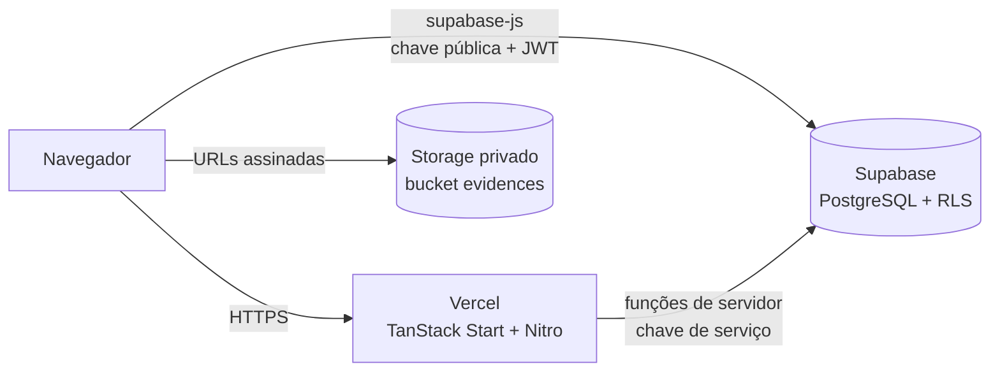

<p align="center">
  
</p>

<h1 align="center">VulnDesk</h1>

<p align="center">
  Plataforma web para gestão centralizada de vulnerabilidades identificadas em testes de intrusão.<br />
  Trabalho de Conclusão de Curso — Sistemas de Informação, PUC Minas (Unidade São Gabriel).
</p>

<p align="center">
  <a href="https://vulndesk-eight.vercel.app"><strong>Acessar a plataforma →</strong></a>
</p>

---

## Sobre

Em muitos testes de intrusão, os achados ficam espalhados em planilhas, relatórios em PDF e trocas de e-mail. O VulnDesk reúne tudo em um só lugar, organizado na hierarquia **Empresa → Projeto → Finding**, com evidências, CVSS, impacto, mitigação e acompanhamento da remediação.

A plataforma atende dois públicos com visões diferentes:

- **Equipe de pentest** — registra e acompanha empresas, projetos, findings e evidências de todos os clientes.
- **Cliente** — consulta, em modo somente leitura, apenas os dados da própria empresa.

A separação é garantida pelo próprio banco de dados (Row Level Security): um cliente não acessa dados de outra empresa nem chamando a API diretamente.

## Funcionalidades

| | |
| --- | --- |
| **Dashboard** | Totais, findings por severidade, status e projeto, evolução dos últimos seis meses e findings recentes |
| **Empresas e projetos** | Cadastro, edição e exclusão com confirmação; tipo de teste, período, horas contratadas e utilizadas |
| **Findings** | Código automático (FIND-001…), severidade, CVSS, descrição, impacto, mitigação, status e data de resolução |
| **Evidências** | Texto (logs, payloads, requisições), imagens e arquivos de até 10 MB em armazenamento privado |
| **Filtros e busca** | Filtros por severidade, status e projeto, busca por código ou título e busca global com `Ctrl/⌘ + K` |
| **Equipe** | Pentesters alocados por projeto e página de cada pentester com seus projetos e findings |
| **Gestão de contas** | Administradores criam, editam e removem usuários e definem o perfil de acesso |

## Perfis de acesso

| Perfil | Permissões |
| --- | --- |
| **Administrador** | Tudo o que o pentester faz, mais a gestão de contas (menu *Usuários*) |
| **Pentester** | Visão global; cria, edita e exclui empresas, projetos, findings e evidências |
| **Cliente** | Somente leitura dos projetos, findings, evidências e dashboard da própria empresa |

Os papéis ficam na tabela `user_roles`, separada do cadastro do usuário. Não existe cadastro público: as contas são criadas no deploy ou por um administrador.

## Acesso para avaliação

A tela de login oferece **acesso rápido** às contas de demonstração (um pentester e três clientes, de empresas diferentes), com a senha exibida na própria tela. As credenciais de administrador e da conta de avaliação são entregues separadamente.

| Conta | E-mail | Perfil |
| --- | --- | --- |
| Administrador | `admin@vulndesk.app` | Admin |
| Avaliação | `professor@vulndesk.app` | Pentester |
| Demonstração | `pentester@example.com` · `bruno.lima@example.com` · `carla.souza@example.com` | Pentester |
| Demonstração | `cliente.alpha@example.com` · `cliente.beta@example.com` · `cliente.gamma@example.com` | Cliente |

Os dados de demonstração são fictícios: 3 empresas, 7 projetos e 24 findings distribuídos nos últimos seis meses.

## Arquitetura



| Camada | Tecnologia |
| --- | --- |
| Interface | React 19, TanStack Router, Tailwind CSS 4, shadcn/ui (Radix), Recharts, lucide-react |
| Estado e cache | TanStack Query |
| Servidor | TanStack Start (funções de servidor) empacotado com Nitro |
| Banco e autenticação | Supabase — PostgreSQL com Row Level Security, Auth e Storage |
| Validação | Zod |
| Hospedagem | Vercel, com deploy automático a cada push na `main` |

O navegador fala direto com o Supabase usando apenas a chave pública; o que cada usuário pode ler ou alterar é decidido pelas políticas RLS. A chave de serviço só existe no servidor, usada nas funções de gestão de contas depois de confirmar que quem chama é administrador.

## Estrutura do repositório

```
├── public/                  ícones e imagem de compartilhamento
├── scripts/
│   ├── db-setup.mjs         aplica migrações, cria contas e dados de demonstração
│   ├── seed-data.mjs        dados fictícios de demonstração
│   └── vercel-build.mjs     build de produção (tipos → banco → app)
├── src/
│   ├── components/          componentes de interface (ui/ = shadcn)
│   ├── hooks/               autenticação e utilidades
│   ├── integrations/supabase/  clientes do Supabase e tipos do banco
│   ├── lib/                 consultas, regras de domínio, storage e funções de admin
│   └── routes/              páginas (roteamento por arquivos)
├── supabase/migrations/     esquema, políticas RLS e storage versionados
└── vercel.json
```

## Segurança

- **RLS em todas as tabelas** — leitura e escrita decididas no banco, por perfil e por empresa.
- **Papéis em tabela própria** (`user_roles`), consultados por funções `SECURITY DEFINER`.
- **Sem cadastro público** — o vínculo de um usuário a um perfil nunca concede papel automaticamente.
- **Evidências privadas** — bucket sem acesso público; arquivos servidos por URLs assinadas de 1 hora.
- **Segredos fora do código** — chaves e senhas apenas em variáveis de ambiente; `.env` fora do Git.
- **Integridade** — exclusão em cascata, enums no banco, `created_at`/`updated_at` em todas as tabelas e verificação de tipos no build.

## Rodando localmente

Pré-requisitos: Node.js 20+ e um projeto Supabase.

```sh
git clone https://github.com/karinabicalho/VulnDesk.git
cd VulnDesk
cp .env.example .env     # preencha com os dados do seu projeto Supabase
npm install
npm run db:setup         # migrações, contas e dados de demonstração
npm run dev              # http://localhost:8080
```

| Script | Função |
| --- | --- |
| `npm run dev` | Servidor de desenvolvimento |
| `npm run build` | Build de produção |
| `npm run typecheck` | Verificação de tipos (TypeScript) |
| `npm run lint` | ESLint |
| `npm run db:setup` | Prepara o banco (pode ser executado várias vezes) |

## Deploy

O projeto está na Vercel, ligado a este repositório e a um banco Supabase pela integração do Marketplace.

1. Importe o repositório na Vercel.
2. Em **Storage**, conecte um banco **Supabase** ao projeto — a integração cria `SUPABASE_URL`, `SUPABASE_SERVICE_ROLE_KEY`, `POSTGRES_URL_NON_POOLING` e as demais variáveis.
3. Defina `VULNDESK_ADMIN_PASSWORD`, `VULNDESK_PROFESSOR_PASSWORD` e `VULNDESK_DEMO_PASSWORD`.
4. Faça o deploy. O `scripts/vercel-build.mjs` verifica os tipos, aplica as migrações pendentes, provisiona as contas e gera o app.

## Rastreabilidade dos requisitos

<details>
<summary>Requisitos funcionais</summary>

| Requisito | Implementação |
| --- | --- |
| RF01 Login com contas de demonstração | `src/routes/auth.tsx`, `scripts/db-setup.mjs` |
| RF02 Perfis Pentester e Cliente | tabela `user_roles`, `src/hooks/use-app-auth.ts` |
| RF03 Hierarquia Empresa → Projeto → Finding | chaves estrangeiras em `supabase/migrations` |
| RF04–RF06 Cadastro de empresas, projetos e findings | `src/routes/_authenticated/{companies,projects,findings}` |
| RF07 Código FIND-001… automático | trigger `set_finding_code` + sequência |
| RF08 Evidências em texto, imagem e arquivo | `src/components/evidence-section.tsx`, bucket `evidences` |
| RF10 Status e data de resolução | página do finding + trigger `set_finding_resolved_at` |
| RF11 Dashboard | `src/routes/_authenticated/dashboard.tsx` |
| RF12 Filtros de findings | `src/routes/_authenticated/findings/index.tsx` |
| RF13 Busca global | `src/components/global-search.tsx` |
| RF14–RF15 Cliente restrito à própria empresa | políticas RLS + interface somente leitura |
| RF16 Equipe por projeto e visão por pentester | `src/components/team-dialog.tsx`, `pentesters/$id.tsx` |
| RF17 Confirmação e exclusão em cascata | `ON DELETE CASCADE` + remoção dos arquivos de evidência |
| RF18 Encerrar sessão | menu do usuário |

</details>

<details>
<summary>Requisitos não funcionais</summary>

| Requisito | Implementação |
| --- | --- |
| RNF01–RNF03 Permissões, papéis e evidências privadas | RLS, `user_roles`, bucket privado com políticas por empresa |
| RNF04 Segredos fora do código | variáveis de ambiente na Vercel; `.env` no `.gitignore` |
| RNF05–RNF08 Interface | tema escuro, cores fixas por severidade e status, menu por perfil, notificações |
| RNF09 Desempenho | cache com TanStack Query |
| RNF10–RNF12 Integridade dos dados | enums, cascata, `created_at`/`updated_at` em todas as tabelas |
| RNF13 Manutenibilidade | TypeScript verificado no build, migrações versionadas |
| RNF14 Disponibilidade | publicado na Vercel, código no GitHub |

</details>

## Autores

Ana Beatriz Costa Viana · Aristides Henrique Gonçalves da Cruz · Grazielle Sorrentino Santos Souza · Gustavo Anselmo Santos Silva · Josué Santana Melo · Karina Oliveira Bicalho de Almeida · Luan Magno Souza Alves · Nicole Marie Agnelo Marques
